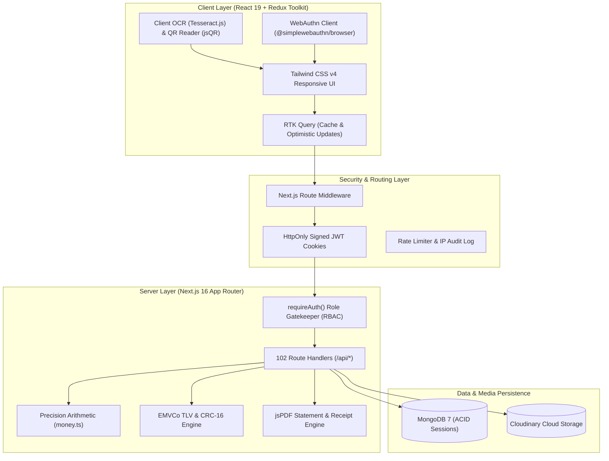
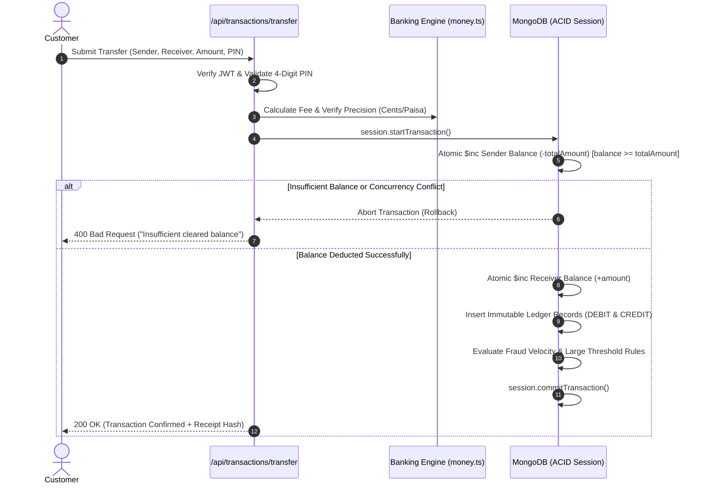

# 🏦 Apex Bank — Enterprise Digital Banking Management System

[](https://nextjs.org/)
[](https://react.dev/)
[](https://www.typescriptlang.org/)
[](https://tailwindcss.com/)
[](https://www.mongodb.com/)
[](https://redux-toolkit.js.org/)
[](https://turbo.build/pack)
[](https://opensource.org/licenses/MIT)

An enterprise-grade, full-stack digital banking and financial services web application built with **Next.js 16 (App Router + Turbopack)**, **React 19**, **TypeScript**, **Tailwind CSS v4**, **Redux Toolkit + RTK Query**, and **MongoDB + Mongoose**.

Apex Bank implements real-world banking infrastructure, including **multi-tier Role-Based Access Control (RBAC)**, **ACID-compliant atomic fund transfers**, **Bangladesh Bank compliant Bangla QR (NPSB-MPM)**, **national telecom airtime recharge**, **Luhn-validated card generation with encrypted credential vaults**, **client-side optical character recognition (OCR) KYC verification**, **WebAuthn passkeys**, **RFC 6238 TOTP two-factor authentication**, and **regulatory PDF statements**.

---

## 📑 Table of Contents

- [System Architecture](#-system-architecture)
- [Key Features](#-key-features)
  - [1. Authentication, Security & Biometrics](#1-authentication-security--biometrics)
  - [2. Multi-Tier Dashboards (RBAC)](#2-multi-tier-dashboards-rbac)
  - [3. Core Banking & Account Management](#3-core-banking--account-management)
  - [4. Atomic Financial Ledger & Transfers](#4-atomic-financial-ledger--transfers)
  - [5. Bangla QR Payment Gateway (NPSB-MPM)](#5-bangla-qr-payment-gateway-npsb-mpm)
  - [6. Mobile Airtime Recharge Gateway](#6-mobile-airtime-recharge-gateway)
  - [7. Card Issuance & Virtual Card Vault](#7-card-issuance--virtual-card-vault)
  - [8. Loan Portfolio Governance & Amortization](#8-loan-portfolio-governance--amortization)
  - [9. Digital KYC with Client-Side OCR](#9-digital-kyc-with-client-side-ocr)
  - [10. Regulatory Statements & Cryptographic Receipts](#10-regulatory-statements--cryptographic-receipts)
  - [11. Fraud Detection & Suspicious Transaction Watch](#11-fraud-detection--suspicious-transaction-watch)
- [Challenges Faced & Engineering Solutions](#-challenges-faced--engineering-solutions)
- [Technology Stack](#-technology-stack)
- [Database Schema & Models](#-database-schema--models)
- [API Architecture](#-api-architecture)
- [Quick Start & Installation](#-quick-start--installation)
- [Demo Credentials](#-demo-credentials)
- [Production Deployment](#-production-deployment)
- [Verification & Quality Assurance](#-verification--quality-assurance)

---

## 🏛️ System Architecture

Apex Bank adheres to a secure multi-layer architecture separating client presentation, edge middleware, server-side route handlers, and database transactions:



---

## ✨ Key Features

### 1. Authentication, Security & Biometrics
- **Stateless JWT Sessions**: Stored strictly in `HttpOnly`, `SameSite=Lax`, and `Secure` cookies to eliminate XSS token theft.
- **Biometric WebAuthn / Passkeys**: Passwordless FaceID/TouchID authentication using `@simplewebauthn/server` and `@simplewebauthn/browser`.
- **RFC 6238 TOTP Two-Factor Authentication**: Dynamic 6-digit authenticator challenges (Google Authenticator, Authy) with QR onboarding.
- **Transaction PIN Vault**: Dedicated 4-digit PIN required for all capital movements (transfers, recharge, QR payments), stored with bcrypt hashing.
- **PIN Reset Governance Desk**: Customers unable to recall transaction PINs submit formal reset petitions; bank officers review account status and authorize one-time resets.
- **IDOR Protection**: All resource requests validate the authenticated user's ownership server-side prior to query execution.

### 2. Multi-Tier Dashboards (RBAC)
- **Customer Portal (`/customer/*`)**:
  - Unified multi-account portfolio overview with real-time balance metrics.
  - Interactive income vs. expenditure cash-flow visualizations via Recharts.
  - Bangla QR merchant payment scanner and peer-to-peer invoice generator.
  - Mobile airtime top-up for all Bangladeshi telecom networks.
  - Virtual card issuance, limits configuration, and CVV reveal.
  - Loan application with dynamic EMI repayment calculator.
  - Account statement generation (1, 3, 6, 12, 24 months) and CSV export.
- **Staff Operations Desk (`/staff/*`)**:
  - Customer onboarding and KYC verification inspection desk.
  - Account provisioning (Savings, Current, Business).
  - Deposit and withdrawal request processing desk.
  - Loan portfolio evaluation and credit assessment forwarding.
  - Customer PIN reset request management desk.
- **Executive Admin Console (`/admin/*`)**:
  - Live system-wide KPI metrics (Total Assets, Aggregate Deposits, Loan Exposure).
  - Staff user provisioning and permission assignment.
  - High-value loan sign-off and automatic balance disbursement.
  - Rule-based Suspicious Transactions Watch (AML/Fraud Engine).
  - System-wide Banking Settings (transfer fees, daily limits, fraud thresholds).
  - Complete immutable audit log browser with IP address tracking.

### 3. Core Banking & Account Management
- **Multi-Account Support**: Customers can maintain multiple distinct accounts (Savings, Current, Business) under a single profile.
- **Real-Time State Transitions**: Accounts transition through `ACTIVE`, `FROZEN`, and `CLOSED` states with audit logging.
- **Account Closure Governance**:
  - Customer submits account closure application specifying an optional payout destination.
  - Bank Staff / Admin verify outstanding balances and approve termination.
  - Transition atomically marks the account `CLOSED` and permanently disables all associated payment cards.

### 4. Atomic Financial Ledger & Transfers


### 5. Bangla QR Payment Gateway (NPSB-MPM)
- Compliant with **Bangladesh Bank Payment Systems Department (PSD)** regulations and **EMVCo Merchant-Presented Mode (MPM)**.
- **Dual Initiation Modes**:
  - **Static QR (Point of Initiation `11`)**: Customer scans the merchant identifier and enters an arbitrary payment sum.
  - **Dynamic QR (Point of Initiation `12`)**: Merchant encodes the exact order amount and bill reference directly into the payload.
- **EMVCo Tag-Length-Value (TLV) Protocol**: Encodes merchant category codes (MCC), transaction currencies (050 BDT), merchant names, cities, and terminal IDs.
- **CRC-16-CCITT Checksum**: Automatic calculation and validation of the 4-character hexadecimal polynomial checksum (`0x1021`).
- **In-Browser Scanner**: Camera-based live scanner and file drag-and-drop decoder powered by `jsQR`.

### 6. Mobile Airtime Recharge Gateway
- Seamless telecom integration supporting all major Bangladeshi carriers:
  - **Grameenphone** (`017`, `013`), **Robi** (`018`), **Banglalink** (`019`, `014`), **Airtel** (`016`), and **Teletalk** (`015`).
  - Supports standard **Prepaid**, **Postpaid**, and **Skitto** connection profiles.
- Operator-specific curated bundle catalog: **Internet Data Packs**, **Voice Minutes**, and **Unlimited Combo Bundles**.
- Server-side PIN authentication, atomic balance debit, and instantaneous transaction receipt generation.

### 7. Card Issuance & Virtual Card Vault
- **Luhn Algorithm (Mod 10)**: Generates 16-digit Primary Account Numbers (PAN) with valid check digits using official Visa (`4532`) and Mastercard (`5324`) Bank Identification Numbers (BIN).
- **PCI-DSS Compliant Credential Masking**: Unmasked card credentials and CVVs are encrypted at rest; customer views display masked identifiers (`**** **** **** 1234`).
- **PIN-Protected Reveal**: Viewing full card numbers and CVVs requires a verified 4-digit card PIN challenge.
- **Fine-Grained Card Controls**: Real-time toggles for:
  - Online E-Commerce transactions
  - In-store Point-of-Sale (POS) swipes
  - Automated Teller Machine (ATM) withdrawals
  - Cross-border international transactions
- **Dynamic Limit Sliders**: Daily transaction ceilings configurable per card.

### 8. Loan Portfolio Governance & Amortization
- **Multi-Category Credit Products**: Personal, Home, Business, Education, and Vehicle loans.
- **Interactive Amortization Engine**: Dynamic Equated Monthly Installment (EMI) calculations displaying monthly breakdown of principal vs. interest.
- **Structured Credit Lifecycle**:
  $$\text{Pending} \longrightarrow \text{Under Review} \longrightarrow \text{Approved} \longrightarrow \text{Active} \longrightarrow \text{Completed}$$
- **Two-Tier Governance**: Staff officers analyze debt-to-income ratios and document dossiers, attaching internal underwriting notes before forwarding to Admin for executive disbursement sign-off.

### 9. Digital KYC with Client-Side OCR
- In-browser Optical Character Recognition using `tesseract.js` paired with HTML5 Canvas image preprocessing (adaptive contrast enhancement and binarization).
- Automatically parses and extracts:
  - Full Legal Name
  - National Identification (NID) / Passport Number
  - Date of Birth
- Eliminates recurring third-party OCR API fees while keeping sensitive government identification data secure on the client edge.
- Cloudinary integration for archival of verified identity documents.

### 10. Regulatory Statements & Cryptographic Receipts
- **Bank-Grade Statement Generator**: Produces 1, 3, 6, 12, and 24-month official PDF account statements using `jsPDF` and `jspdf-autotable`.
- **Security Features**:
  - Official regulatory header and dual security borders.
  - High-resolution circular bank watermark and authorization seal.
  - Cryptographic verification QR code embedding SHA-256 transaction root hashes.
  - Financial summary KPIs: Opening Balance, Total Debits, Total Credits, and Closing Balance.

### 11. Fraud Detection & Suspicious Transaction Watch
- **Automated Rule Engine**:
  - **Threshold Breaches**: Automatically flags single transfers exceeding configurable amounts (e.g. \$15,000+).
  - **Velocity Analysis**: Flags rapid successive transactions executed within tight temporal windows.
  - **Round-Number Anomalies**: Flags suspicious high-value round sums.
- **Administrative Watchlist**: Admin review desk providing 1-click **Dismiss Flag** or **Freeze Sender Account** actions.

---

## 💡 Challenges Faced & Engineering Solutions

Developing an enterprise-grade digital banking system requires solving complex software engineering and regulatory challenges. Below are the core technical hurdles faced during this project and how they were solved:

### 1. Financial Precision & Floating-Point Rounding Hazards
- **The Challenge**: JavaScript uses IEEE 754 double-precision binary floating-point numbers. Standard arithmetic leads to precision errors (e.g., `0.1 + 0.2 = 0.30000000000000004`). In a banking ledger, compound interest calculations, multi-currency fees, and fractional transactions would accumulate discrepancies, corrupting account balances.
- **The Solution**: 
  - Built a dedicated financial math library ([money.ts](file:///persistent/home/rihad/Developer/dev/bank-app/src/lib/money.ts)) that executes all arithmetic in integer minor units (cents / poisha).
  - Backed MongoDB schemas with `mongoose.Schema.Types.Decimal128` to maintain exact decimal representation.
  - Strictly prohibited any client-side balance calculations; all transfer totals, fees, and balance mutations are computed exclusively on the server.

### 2. Double-Spending & Concurrency Race Conditions in Fund Transfers
- **The Challenge**: In peer-to-peer transfers, if a user initiates two rapid requests simultaneously or if an unexpected network failure occurs midway through a transfer (after debiting the sender but before crediting the recipient), funds could duplicate or disappear.
- **The Solution**:
  - Implemented **MongoDB Multi-Document ACID Transactions** via Mongoose replica sessions (`session.startTransaction()`).
  - Applied atomic conditional updates (`$inc` with `$gte` queries):
    ```typescript
    const updatedSender = await BankAccount.findOneAndUpdate(
      { _id: senderId, balance: { $gte: totalDeduction } },
      { $inc: { balance: -totalDeduction } },
      { session, new: true }
    );
    ```
  - If the sender lacks cleared funds or if another operation mutates the record concurrently, the transaction throws an exception and automatically calls `session.abortTransaction()`, ensuring absolute zero loss of capital.

### 3. Conformance with Bangladesh Bank & EMVCo Bangla QR Specifications
- **The Challenge**: Generating arbitrary QR codes or plain JSON payloads does not work with national payment applications (such as bKash, Nagad, or commercial banking apps). The Bangladesh Bank PSD Circular mandates strict compliance with the EMVCo Merchant-Presented Mode (MPM) standard, requiring Tag-Length-Value (TLV) payload structures and CRC-16-CCITT checksum verification.
- **The Solution**:
  - Developed a standalone EMVCo TLV engine ([bangla-qr.ts](file:///persistent/home/rihad/Developer/dev/bank-app/src/lib/bangla-qr.ts)) supporting Tag 00 (Payload Format Indicator), Tag 01 (Point of Initiation Method), Tag 26-51 (Merchant Account Info), Tag 52 (Merchant Category Code), Tag 53 (Transaction Currency), and Tag 54 (Transaction Amount).
  - Implemented the standard CRC-16-CCITT polynomial algorithm (`0x1021` with initial value `0xFFFF`):
    ```typescript
    export function calculateCRC16(payload: string): string {
      let crc = 0xffff;
      for (let i = 0; i < payload.length; i++) {
        crc ^= payload.charCodeAt(i) << 8;
        for (let j = 0; j < 8; j++) {
          crc = (crc & 0x8000) ? ((crc << 1) ^ 0x1021) : (crc << 1);
        }
      }
      return (crc & 0xffff).toString(16).toUpperCase().padStart(4, "0");
    }
    ```
  - Both static (POI `11`) and dynamic (POI `12`) payloads are fully validated against this standard.

### 4. Client-Side Document OCR without Heavy SaaS Latency or Privacy Leaks
- **The Challenge**: Automated KYC verification requires extracting name, NID number, and date of birth from uploaded ID cards or passports. Relying on paid cloud OCR APIs (e.g. AWS Textract, Google Cloud Vision) introduces recurring operational costs, network latency, and privacy compliance concerns regarding citizen identity documents.
- **The Solution**:
  - Integrated `tesseract.js` directly within the browser runtime paired with pre-trained models ([eng.traineddata](file:///persistent/home/rihad/Developer/dev/bank-app/eng.traineddata)).
  - Built an image pre-processing pipeline using HTML5 Canvas that applies grayscale conversion, adaptive thresholding, and contrast stretching before OCR ingestion.
  - Implemented regex pattern matchers specifically tuned for Bangladeshi Smart NIDs (10-digit / 17-digit formats) and international passports, extracting clean identity fields instantly on the client edge.

### 5. Next.js 16 (App Router + Turbopack) & React 19 Ecosystem Migration
- **The Challenge**: Next.js 16 and React 19 introduce major architectural shifts: dynamic server APIs (`headers()`, `cookies()`, and route `params`) are strictly asynchronous Promises, and Tailwind CSS v4 utilizes a completely new compilation engine that replaces legacy PostCSS plugins. Older libraries and patterns cause hydration errors and build failures.
- **The Solution**:
  - Refactored all route handlers and server layouts to cleanly `await` asynchronous context parameters (`const { id } = await params;`).
  - Configured `@tailwindcss/turbopack` in [package.json](file:///persistent/home/rihad/Developer/dev/bank-app/package.json) for high-speed Turbopack compilation.
  - Cleanly decoupled server-side route guards from client-side Redux Toolkit providers, achieving a 100% clean production build (`npm run build`) with zero compiler warnings across all 102 application routes.

### 6. Card Security, Luhn Algorithm & Cryptographic Credential Vault
- **The Challenge**: Issuing payment cards requires generating authentic 16-digit Primary Account Numbers (PAN) with valid checksums matching international card networks (Visa BIN `4532`, Mastercard BIN `5324`), while adhering to PCI-DSS standards by not exposing unmasked PANs and CVVs to client bundles.
- **The Solution**:
  - Implemented the Luhn algorithm (Modulo 10 check digit) in [cards.ts](file:///persistent/home/rihad/Developer/dev/bank-app/src/lib/cards.ts) to calculate and verify authentic PAN structures.
  - Applied symmetric credential masking (`**** **** **** 1234`) on all standard API responses.
  - Implemented a secure backend reveal endpoint (`/api/cards/[id]`) that requires the customer to provide their verified 4-digit card PIN before returning unmasked card details.

### 7. Dual Navigation Active Highlights & Deep Mobile Responsiveness
- **The Challenge**: In complex multi-tier dashboards with nested subroutes (e.g. `/staff/accounts` and `/staff/accounts/create`), naive path prefix matching caused both "Accounts List" and "Issue Account" to highlight simultaneously. Additionally, dense data tables and badges caused multi-line text wrapping and layout breakages on mobile screens (320px–440px).
- **The Solution**:
  - Engineered hierarchical route-matching logic in [Sidebar.tsx](file:///persistent/home/rihad/Developer/dev/bank-app/src/components/layout/Sidebar.tsx):
    ```typescript
    const isActive =
      pathname === item.href ||
      (pathname.startsWith(`${item.href}/`) &&
        !currentNavItems.some(
          (other) =>
            other.href !== item.href &&
            other.href.startsWith(item.href) &&
            (pathname === other.href || pathname.startsWith(`${other.href}/`))
        ));
    ```
  - Standardized core components ([Modal.tsx](file:///persistent/home/rihad/Developer/dev/bank-app/src/components/ui/Modal.tsx), [Badge.tsx](file:///persistent/home/rihad/Developer/dev/bank-app/src/components/ui/Badge.tsx), [Button.tsx](file:///persistent/home/rihad/Developer/dev/bank-app/src/components/ui/Button.tsx)) with `whitespace-nowrap shrink-0` and mobile scrollable containers.
  - Converted table pagination footers across 15 management views to responsive flex layouts (`flex-col sm:flex-row gap-3`).

### 8. Multi-Page Statement PDF Table Overflows with AutoTable
- **The Challenge**: When compiling long account statements (up to 24 months of activity) into formal PDFs via `jspdf` and `jspdf-autotable`, long descriptions or date timestamps caused table columns to exceed the 182mm print boundary, bleeding past the right page margin and breaking multi-page layout integrity.
- **The Solution**:
  - Re-architected [statement-pdf.ts](file:///persistent/home/rihad/Developer/dev/bank-app/src/lib/statement-pdf.ts) with dynamic column sizing: fixed widths for Date (22mm), Type (20mm), Amount (26mm), and Balance (26mm), with the Particulars/Description column set to `cellWidth: "auto"`.
  - Configured `margin: { left: 14, right: 14 }` with continuous dual security border drawing hooks (`didDrawPage`) ensuring consistent borders, footers, and page numbers across all pages.

### 9. Vercel Public Environment Variable Prefix Incompatibilities
- **The Challenge**: During cloud deployment to Vercel, using `NEXT_PUBLIC_APP_URL` and `NEXT_PUBLIC_APP_NAME` for private backend configurations triggered Vercel CLI warnings and validation blocks, as public prefixes expose values to client bundles and prevent marking variables as Sensitive.
- **The Solution**:
  - Migrated core environment configurations in [.env.local](file:///persistent/home/rihad/Developer/dev/bank-app/.env.local) and [.env.example](file:///persistent/home/rihad/Developer/dev/bank-app/.env.example) to private variables: `APP_NAME` and `APP_URL`.
  - Updated backend services ([passkey.ts](file:///persistent/home/rihad/Developer/dev/bank-app/src/lib/passkey.ts) and [2fa/generate/route.ts](file:///persistent/home/rihad/Developer/dev/bank-app/src/app/api/auth/2fa/generate/route.ts)) with graceful fallbacks:
    ```typescript
    export const APP_NAME = process.env.APP_NAME || process.env.NEXT_PUBLIC_APP_NAME || "Apex Bank";
    export const APP_URL = process.env.APP_URL || process.env.NEXT_PUBLIC_APP_URL || "http://localhost:3000";
    ```

---

## 🛠️ Technology Stack

| Domain | Technology | Version | Purpose |
| :--- | :--- | :--- | :--- |
| **Framework** | Next.js (App Router) | `16.4.6` | Full-stack React framework with Server Components & Turbopack |
| **Core UI Library** | React / React DOM | `19.3.0` | Declarative component UI engine |
| **Programming Language** | TypeScript | `5.0+` | End-to-end static typing and interface contracts |
| **Styling & Design System**| Tailwind CSS | `4.0` | Utility-first CSS engine with custom banking design tokens |
| **State Management** | Redux Toolkit & RTK Query | `2.15.0` | Global state, API query caching, and cache invalidation tags |
| **Database** | MongoDB 7 / Mongoose | `9.12.3` | Document store with ACID multi-document transactions |
| **Authentication** | JWT & bcryptjs | `9.0 / 3.0` | Stateless cookie sessions and salted password/PIN hashing |
| **Biometric Auth** | SimpleWebAuthn | `14.1.0` | FIDO2 / WebAuthn passkey server & browser integration |
| **Two-Factor Auth** | otplib & qrcode | `13.6 / 1.5` | RFC 6238 TOTP engine with dynamic QR setup |
| **Data Validation** | Zod & React Hook Form | `4.6 / 7.92` | Schema-driven form and API request payload validation |
| **Charts & Analytics** | Recharts | `3.11.0` | Responsive financial trend and cash-flow visualizations |
| **Client OCR Engine** | Tesseract.js | `7.0.0` | Pure client-side Optical Character Recognition for NID/KYC |
| **QR Code Scanner** | jsQR | `1.4.0` | In-browser canvas QR code decoding engine |
| **PDF Generation** | jsPDF & jspdf-autotable | `4.2 / 5.0` | Regulatory statements and transaction receipts |
| **Cloud Storage** | Cloudinary SDK | `2.11.0` | Media and document storage with WebP transformations |
| **Toast Notifications** | Sonner | `2.0.8` | Accessible toast notification system |
| **Iconography** | Lucide React | `1.77.0` | Consistent vector iconography |

---

## 📊 Database Schema & Models

Apex Bank implements an interconnected, relational-grade document model in MongoDB:

| Model | Collection | Primary Responsibility | Key Fields & Indexes |
| :--- | :--- | :--- | :--- |
| **User** | `users` | Customer, Staff, and Admin identity records | `email`, `role`, `status`, `kycStatus`, `password`, `transactionPin` |
| **BankAccount** | `bankaccounts` | Savings, Current, and Business accounts | `accountNumber` (Unique), `userId`, `balance` (Decimal128), `status` |
| **Transaction** | `transactions` | Immutable double-entry financial ledger | `transactionId` (Unique), `senderAccount`, `receiverAccount`, `amount`, `type`, `status` |
| **Card** | `cards` | Luhn-validated virtual and physical payment cards | `cardNumberMasked`, `cardType`, `network`, `expiryDate`, `limits`, `controls` |
| **CardRequest** | `cardrequests` | Customer applications for new card issuance or removal | `userId`, `accountId`, `cardType`, `network`, `requestType`, `status` |
| **AccountClosureRequest** | `accountclosurerequests` | Formal petitions to close bank accounts | `userId`, `accountId`, `payoutAccountId`, `reason`, `status` |
| **Loan** | `loans` | Credit dossiers, terms, and approval workflows | `loanReference`, `userId`, `accountId`, `principal`, `interestRate`, `status` |
| **DepositRequest** | `depositrequests` | Customer deposit review queue | `userId`, `accountId`, `amount`, `depositMethod`, `status` |
| **WithdrawalRequest** | `withdrawalrequests`| Customer cash withdrawal review queue | `userId`, `accountId`, `amount`, `status` |
| **PinResetRequest** | `pinresetrequests` | Customer forgotten PIN reset petitions | `userId`, `reason`, `status`, `reviewedBy` |
| **Passkey** | `passkeys` | FIDO2 WebAuthn public key credentials | `userId`, `credentialId`, `publicKey`, `counter`, `deviceType` |
| **BankingSettings** | `bankingsettings` | Global bank configuration parameters | `transferFeePercent`, `minTransferAmount`, `fraudThresholdAmount` |
| **Notification** | `notifications` | In-app alerts and notifications | `userId`, `title`, `message`, `type`, `isRead` |
| **AuditLog** | `auditlogs` | Immutable audit trail of administrative actions | `actorId`, `action`, `targetId`, `ipAddress`, `timestamp` |

---

## 🔌 API Architecture

Apex Bank features over **102 Route Handlers** adhering to RESTful standards and strict server-side validation:

```
src/app/api/
├── auth/
│   ├── login/                     # JWT session initiation
│   ├── register/                  # New user registration
│   ├── logout/                    # Cookie revocation
│   ├── me/                        # Session profile lookup
│   ├── 2fa/ (setup, verify)       # RFC 6238 TOTP management
│   ├── passkey/ (register, auth)  # FIDO2 WebAuthn registration & verification
│   └── pin-reset-request/         # Customer forgotten PIN petition
├── accounts/
│   ├── route.ts                   # Account lookup & creation
│   ├── my/                        # Current user accounts
│   ├── closure-requests/          # Account termination desk
│   └── [id]/                      # Status freeze/unfreeze/closure
├── transactions/
│   ├── transfer/                  # ACID atomic intra-bank fund transfer
│   ├── deposit-request/           # Submit deposit request
│   ├── withdrawal-request/        # Submit withdrawal request
│   └── suspicious/                # Suspicious transaction review & freeze
├── payments/
│   ├── bangla-qr/                 # NPSB-MPM QR verification & payment
│   └── recharge/                  # Mobile telecom airtime recharge
├── cards/
│   ├── route.ts                   # Issue Luhn card (Staff/Admin)
│   ├── my/                        # Customer cards overview
│   ├── requests/                  # Card issue/cancel governance
│   └── [id]/ (reveal, limits)     # PIN-authenticated CVV reveal & limit controls
├── loans/
│   ├── route.ts                   # Submit loan application
│   ├── my/                        # Customer active loans
│   └── [id]/                      # Staff review & Admin disbursement
├── kyc/
│   ├── submit/                    # Upload identity document
│   └── [id]/                      # Officer KYC audit & verification
├── ocr/scan/                      # Edge document field extraction
└── settings/                      # Global fees, limits, and fraud thresholds
```

---

## 🚀 Quick Start & Installation

### Prerequisites
- **Node.js**: `20.x` or higher
- **MongoDB**: `7.x` or higher (Local daemon or MongoDB Atlas)

### 1. Clone the Repository
```bash
git clone https://github.com/rihadjahanopu/bank-app.git
cd bank-app
```

### 2. Install Dependencies
```bash
npm install
```

### 3. Configure Environment Variables
Create a `.env.local` file in the root directory:
```bash
cp .env.example .env.local
```

Populate the configuration values:
```env
# Application Info
APP_NAME="Apex Bank"
APP_URL="http://localhost:3000"

# Database Connection
MONGODB_URI="mongodb://127.0.0.1:27017/bank_app"

# Security & Authentication Secrets
JWT_SECRET="generate-a-secure-random-64-character-string"
PASSKEY_RP_ID="localhost"

# Cloud Media Storage (Cloudinary)
CLOUDINARY_CLOUD_NAME="your_cloud_name"
CLOUDINARY_API_KEY="your_api_key"
CLOUDINARY_API_SECRET="your_api_secret"
```

### 4. Seed the Database
Populate pre-configured test customers, accounts, loans, cards, and transaction records:
```bash
npm run seed
```

### 5. Start Development Server
```bash
npm run dev
```
Navigate to [http://localhost:3000](http://localhost:3000) in your browser.

---

## 👤 Demo Credentials

The login page includes convenient **1-Click Demo Fill Buttons** to test any role instantly:

| Role | Email Address | Password | Transaction PIN | Primary Permissions |
| :--- | :--- | :--- | :---: | :--- |
| **Executive Admin** | `admin@apexbank.com` | `AdminPassword123!` | — | Full system governance, loan disbursement, fraud watch, global settings, staff provisioning |
| **Bank Staff** | `staff@apexbank.com` | `StaffPassword123!` | — | Customer registration, KYC verification, card requests review, deposit/withdrawal processing, PIN reset desk |
| **Customer** | `customer@apexbank.com` | `CustomerPassword123!` | `1234` | Multi-account overview, transfers, Bangla QR payments, mobile recharge, virtual cards, loan applications |

---

## 🚢 Production Deployment

### Vercel Deployment
1. Connect your repository to **Vercel**.
2. Configure your Environment Variables in the Vercel Dashboard:
   - `APP_NAME`: `Apex Bank`
   - `APP_URL`: `https://your-domain.vercel.app`
   - `MONGODB_URI`: Connection string to your MongoDB Atlas cluster.
   - `JWT_SECRET`: High-entropy 64-character secret.
   - `PASSKEY_RP_ID`: Your production domain hostname (e.g. `your-domain.vercel.app`).
   - `CLOUDINARY_*`: Cloudinary credentials.
3. Deploy! Next.js will build all routes using Turbopack.

---

## 🧪 Verification & Quality Assurance

Apex Bank maintains strict production quality benchmarks:

```bash
# Execute Next.js Turbopack production compilation
npm run build

# Run static TypeScript type checks and ESLint rules
npm run lint

# Seed fresh mock data
npm run seed
```

- **Build & Compilation**: 102/102 routes compiled successfully with 0 errors (Next.js 16.4.6 + Turbopack).
- **Type Safety**: 100% strict TypeScript types and Zod runtime schema validation.
- **Responsive Viewport Coverage**: Validated on mobile (320px, 375px, 414px), tablet (768px), laptop (1024px), and desktop (1440px+).

---

## 📄 License

This project is licensed under the [MIT License](LICENSE).

---

<p align="center">
  <b>Apex Bank</b> — Engineered with precision for next-generation digital banking.
</p>
